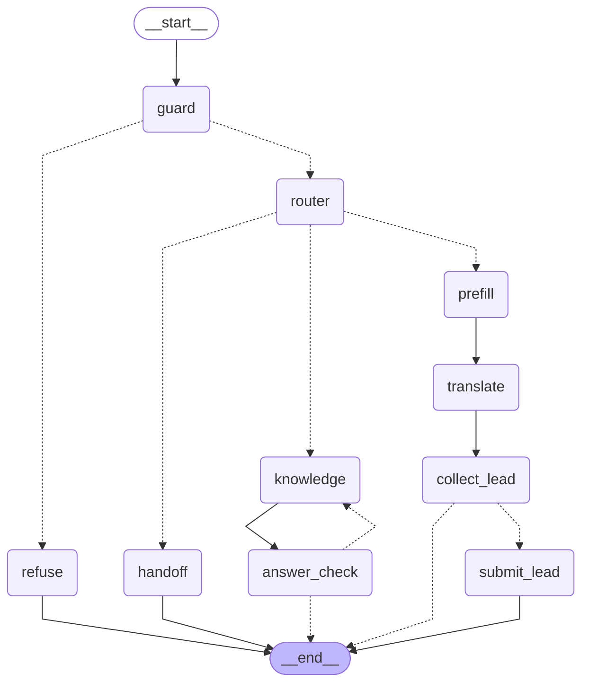

# Support agent graph

Generated from `agent/graph.py` by `scripts/draw_graph.py`. Do not edit by hand.

- **Solid arrow**: always goes to the next step.
- **Dotted arrow**: a decision. The step picks one of the routes.
- `guard` is the only way in, so every message is checked before anything else runs.
- `collect_lead` pauses after each question and waits for the customer's answer.
- `answer_check` can send a draft back to `knowledge` for a rewrite (a capped loop).

